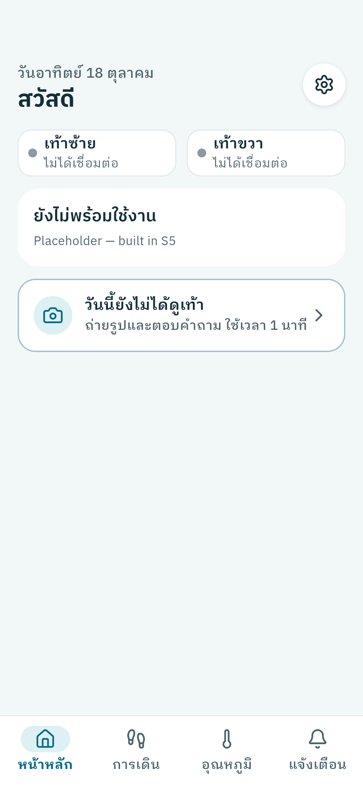
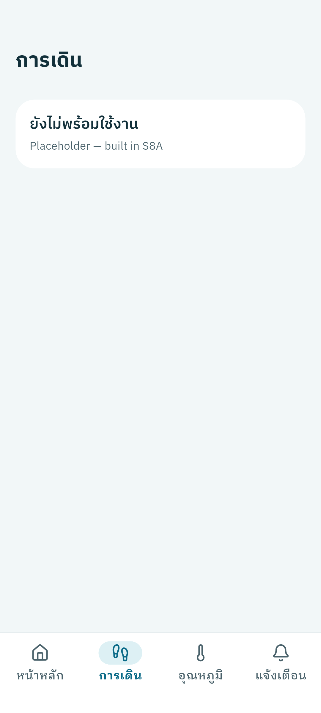
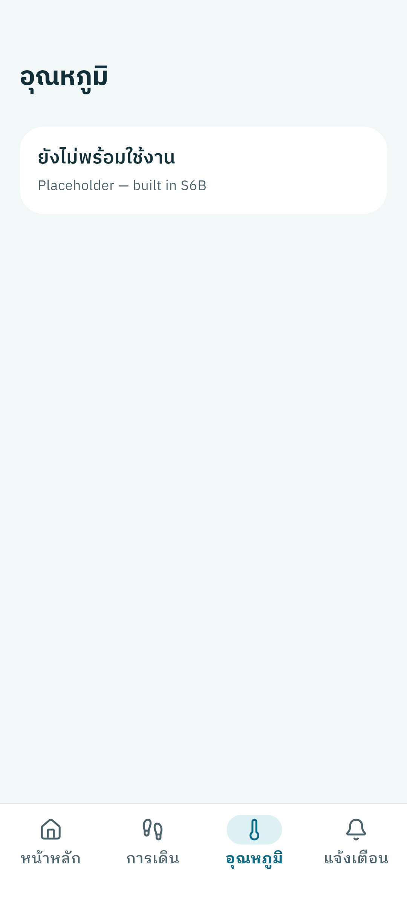
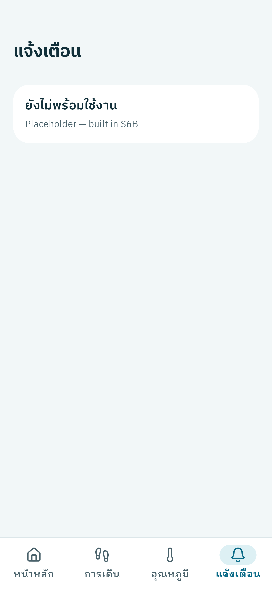
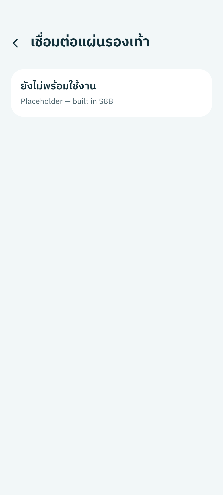
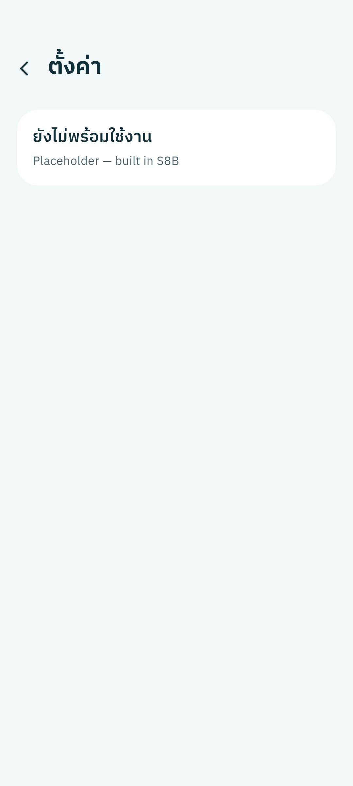
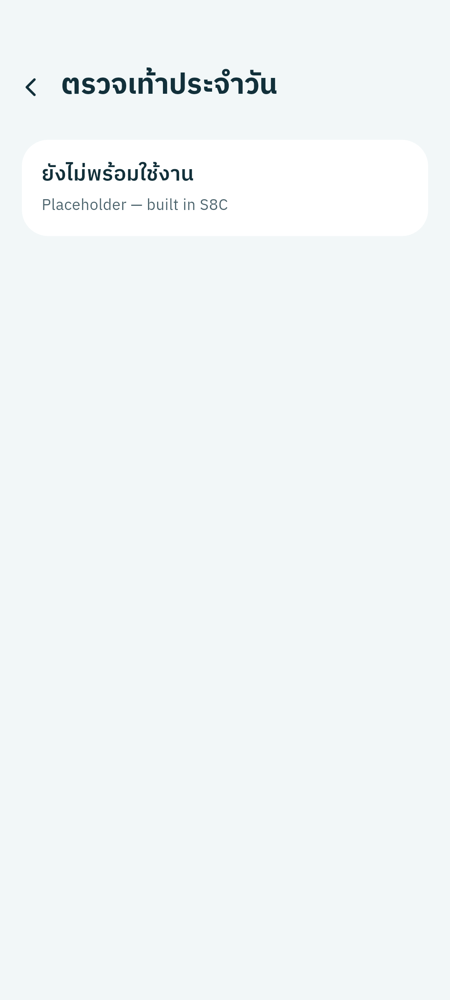

# 020 — Flutter `mobile/` scaffold + theme (S1B)

Session S1B from `docs/SESSIONS.md`. Creates the Flutter app skeleton that
every later session builds on. No data, BLE or rules logic.

Branch `work/flutter-scaffold`. Requires S0B merged: yes (`main` at b4c46ab
includes PR #15).

## What was done

- **Plan docs v2.** First commit (e57d575): `docs/SESSIONS.md` and
  `docs/FLUTTER-PLAN.md` replaced with the user's updated versions from
  `~/Downloads`. The test strategy changes to emulator + Dart MCP + golden
  tests, with the Note 10 used only at 4 checkpoints. Both files are
  byte-identical to the originals (`cmp` and SHA-256 match:
  `88315861…` / `bee0cbac…`).
- **Project.** `flutter create --platforms android --org th.ac.kmutt
  --project-name smartinsole mobile`. The user chose this so the
  application id is `th.ac.kmutt.smartinsole` and the Dart package is
  `smartinsole`. Flutter 3.47.7 / Dart 3.13.5.
- **Packages** (latest stable at install time):
  - S1B list: `flutter_riverpod` 3.4.3, `flutter_animate` 4.5.2,
    `animations` 3.0.0.
  - Approved by the user during the session:
    - `flutter_lucide` 1.59.0 (MIT). Gives the exact Lucide icon names that
      DESIGN-SPEC uses.
    - `flutter_localizations` (SDK) and `intl` 0.20.3. See "Locale change"
      below.
  - Dev only: `flutter_driver` (SDK).
  - `cupertino_icons` removed.
- **Folders** per FLUTTER-PLAN §3: `lib/{ble,device,rules,gait,footcheck,
  storage,notify,config,ui}`. Each empty folder has a one-line `README.md`
  naming the session that fills it.
- **Fonts.** These are bundled in `assets/fonts/`:
  - IBM Plex Sans Thai 500/600/700
  - IBM Plex Sans Thai Looped 400/500/600/700

  Downloaded from `google/fonts` (`ofl/ibmplexsansthai`,
  `ofl/ibmplexsansthailooped`). The licence is SIL OFL 1.1, checked, and
  identical for both families; it's copied to `assets/fonts/OFL.txt`. No
  runtime download.
- **Theme** (`lib/ui/theme/`):
  - `colors.dart`: every DESIGN-SPEC §1 token, plus status palettes, foot
    dots and camera colours. No kPa boundaries.
  - `typography.dart`: the §2 scale. Headings use Plex Sans Thai, body uses
    Looped, line height 1.45.
  - `dimens.dart`: §3 spacing, radii, touch targets, bar height, and the
    floating-button shadow.
  - `app_theme.dart`: Material 3 theme with pill buttons at 56/52 high and
    cards with no elevation and radius 24.
- **Motion** (`lib/ui/motion.dart`):
  - Durations 200/300/400 ms, plus a 1.6 s pulse.
  - Curves `easeOutCubic` / `easeInCubic`.
  - `Motion.reduced()` and `Motion.duration()` return zero under reduce
    motion.
  - Page transitions use the `animations` shared-axis transition, wrapped so
    they are skipped entirely under reduce motion.
- **Screens and navigation.**
  - `AppShell` holds the 4 tabs in an `IndexedStack`, with a custom bottom
    bar per DESIGN-SPEC §4:
    - height 80
    - selected tab: 56×30 `primarySoft` pill, label in `primary`/700
    - Lucide `house` / `footprints` / `thermometer` / `bell`
    - a badge slot on Alerts, hidden at 0
  - Named routes for Connection, Settings and Foot check. Pushed screens use
    a back button with the TalkBack label "กลับ".
  - Home has:
    - the date header (intl, Thai)
    - the greeting
    - a 48×48 gear button with the TalkBack label "ตั้งค่า"
    - left/right foot buttons, grey dot + "ไม่ได้เชื่อมต่อ", that open
      Connection
    - a placeholder for the S5 content
    - the **foot-check card slot**, styled per §5 item 4. It is always
      shown and opens Foot check; there is no "done today" logic.
- **`mobile/CLAUDE.md`** covers:
  - the 16 rules, verbatim
  - commands
  - folder map
  - theme and motion rules
  - "do not touch the web app"
  - the English-only rule
  - the testing approach: emulator + Dart MCP + goldens, Note 10 only at
    S3A/S4/S8C/S9
- **Tests** (17):
  - `flutter_test_config.dart` loads every font in `FontManifest.json`
    (Plex Thai families + Lucide), so goldens render real glyphs.
  - `pumpApp()` fixes the clock and size (390×844, dpr 2) and can turn on
    reduce motion.
  - 7 goldens, one per screen.
  - Navigation tests: every tab; gear, both foot buttons and the foot-check
    card open the right screen, and back returns Home.
  - Page transition present with motion on, absent under reduce motion.
  - `Motion.duration` unit tests.
- **`test_driver/main_mcp.dart`**: an entrypoint with the Flutter Driver
  extension, so the Dart MCP server can tap and take screenshots. It lives
  outside `lib/`, so `flutter_driver` stays a dev dependency.

### Locale change (user decision during the session)

The first version set `locale: th`, but `flutter_localizations` wasn't
present yet. Every screen with an `AppBar` then crashed in tests with "No
MaterialLocalizations found". The user approved adding `flutter_localizations`
(SDK) and `intl`. As committed in 4479dc2:

- **Locale.** `MaterialApp` uses `locale: th_TH`,
  `supportedLocales: [th_TH]` and
  `localizationsDelegates: GlobalMaterialLocalizations.delegates`.
- **Test harness.** The harness pumps the real `SmartInsoleApp`, so the
  tests get the same delegates. That fixed the crash.
- **Home date.** It now uses `DateFormat('EEEE d MMMM', 'th')`, for example
  "วันอาทิตย์ 18 ตุลาคม". This replaces a hand-written formatter.
- **Home golden.** It was regenerated. The golden diff touched only the
  date line (0.25 % of pixels), and nothing else moved.
- **On the emulator.** The runtime locale is `th_TH`, read from the widget
  tree.

### Fix found during the emulator walkthrough

Two alignment problems, fixed in f0e2bbf with goldens regenerated:

- Tab screen titles sat 16 px from the edge while cards sit at 20 px.
  `AppBarTheme.titleSpacing` is now `Dimens.pagePadding`.
- On pushed screens the title had a wide gap after the back button. Those
  screens now use `titleSpacing: 0`.

## Checks

| Check | Result |
|---|---|
| `flutter analyze` | **Pass**: no issues |
| `flutter test` | **Pass**: 17/17 |
| Goldens committed, one per screen (7) | **Pass**: `mobile/test/goldens/screens/*.png` |
| Widget test: every screen opens | **Pass**: `test/navigation_test.dart` |
| All 7 screens reachable on the emulator | **Pass**: Pixel 7 AVD (`emulator-5554`, API 37, 1080×2400). Navigated with `flutter_driver_command tap`; back tested via the "กลับ" tooltip |
| Screenshots via Dart MCP | **Pass**: `flutter_driver_command screenshot`, below |
| Runtime errors | **Pass**: `get_runtime_errors` reported none, after a hot restart and after the full walkthrough |
| Thai renders with the bundled fonts | **Pass**: visually Plex/Looped. The widget tree shows `family: PlexSansThai`, 19/600, colour `#12303A` on the placeholder card title |
| Theme matches DESIGN-SPEC | **Pass** for what exists: bg `#F2F7F8`, white cards with radius 24 and no shadow, 20 px page padding, tab pill and labels per §4, foot-check card per §5 item 4. Status card, foot map and small cards are S5 |
| Reduce motion (rule 16) | **Pass (widget test only)**: transition is skipped and durations are zero. Not re-checked on the emulator; S1B has no animations besides page transitions and the tab pill |
| Rule 5: no-data never green | **Pass**: foot buttons use the grey dot `#8A9AA1`; placeholders use no status colour |
| Rule 12: no thresholds in code | **Pass**: no kPa values anywhere in `mobile/lib`. Hex colours appear only in `lib/ui/theme/` |
| Motion constants in one file | **Pass**: no `Duration(` in `mobile/lib` outside `motion.dart` |
| Web app untouched | **Pass**: `git diff main --name-only` has nothing under `src/ css/ public/ index.html package*.json` or the web config |

The other 16 rules (1–4, 6–11, 13–15) concern data, BLE, rules and photos,
none of which exist yet.

## Screenshots (emulator, Pixel 7 AVD)

| Home | Gait | Temperature | Alerts |
|---|---|---|---|
|  |  |  |  |

| Connection | Settings | Foot check |
|---|---|---|
|  |  |  |

The Home screenshot was taken before the title-spacing fix. Home has no
`AppBar`, so the fix doesn't change it.

## Leftovers

Added to `docs/BACKLOG.md` item 14:

- `AppBar` titles cap text scaling at 1.34×. This is Flutter's own
  behaviour, and it conflicts with "never clamp".
- There is no large-text golden yet.
- The Home greeting has no name source.
- Placeholder cards show an English developer line.
- Reduce motion was checked only in widget tests.

Tooling notes:

- **Screenshot timing.** A driver `screenshot` sent in parallel with a `tap`
  can capture the previous frame. Send them one after the other.
- **Goldens are host-rendered** on the Linux dev machine. Another OS may
  differ by a few pixels.

## Decisions needed

- Whether screen titles should stay as `AppBar` titles (text scaling capped
  at 1.34×) or become in-body headings. Not urgent; best decided before
  S5/S8B.
- Where the patient's name in "สวัสดี คุณ[name]" comes from. Probably
  Settings, S8B.

## Next session

S2A: parser + test vectors (requires this PR merged).
