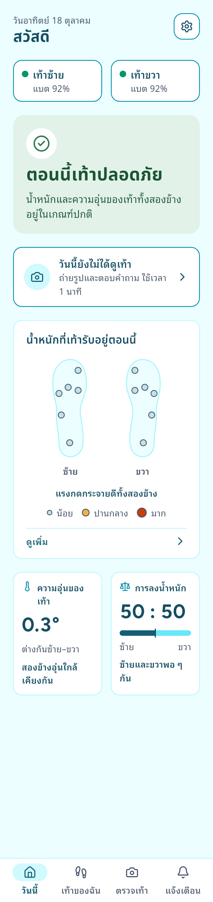
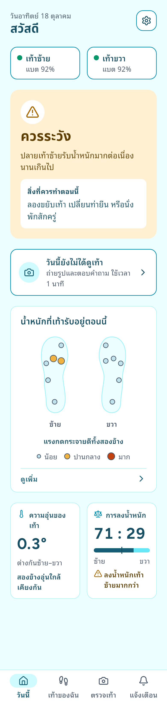
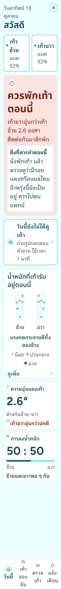
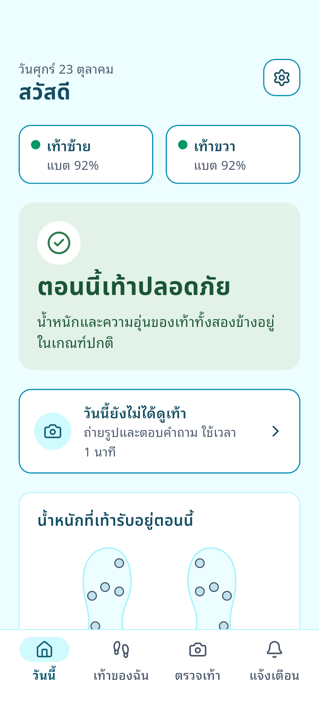
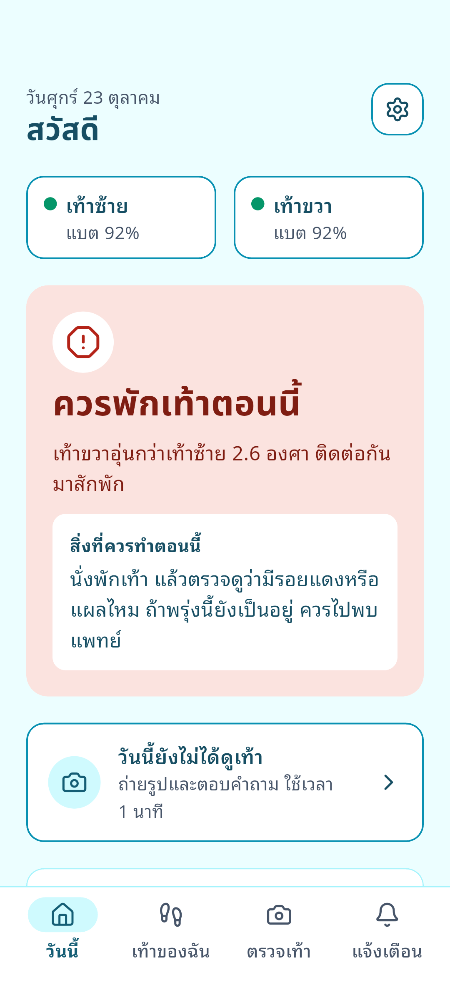
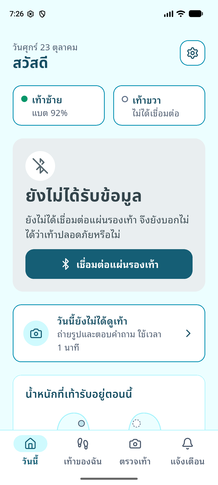
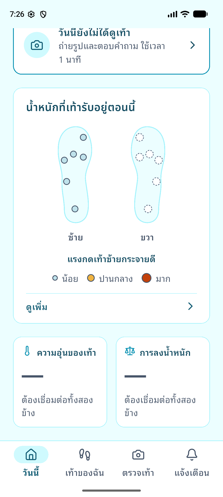
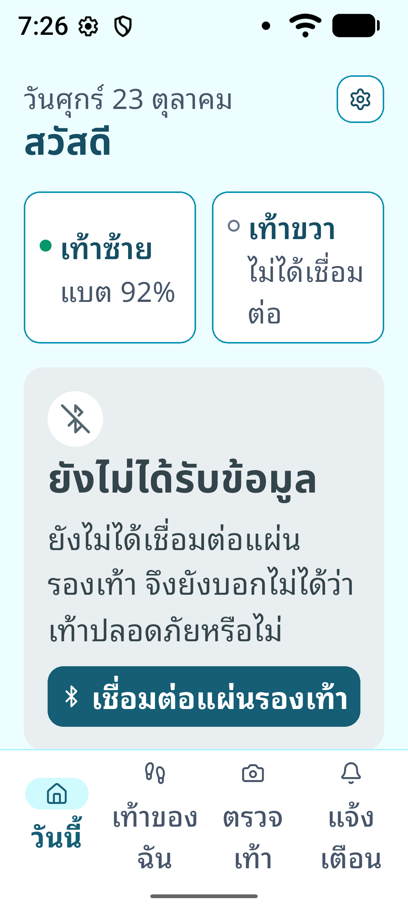

# 028 — S5: Home in style D (Flutter)

Branch `work/s5-home-style-d` · 2026-10-23 · Session S5 (`docs/SESSIONS.md` §3)
Spec: `docs/design/DESIGN-SPEC.md` v2 §1–§6, §12, §13.

**Status: Note 10 checkpoint run, every item passes (section "Note 10
checkpoint results"); waiting for the user's acceptance.** One
accessibility bug found on the phone and the `watch` preset found in the
design review are both fixed.

> **Level 3 is not checked until S7.** In S5, Home's "ควรระวัง" (Be
> careful) state only appears from the `watch` mock preset. No rule
> evaluates `PRESSURE_PEAK`, `PRESSURE_PTI` or `LOAD_CONCENTRATION` yet.
> **With real insoles, Home can show "ตอนนี้เท้าปลอดภัย" while a level-3
> condition is true.** "ควรพักเท้าตอนนี้" (Rest, `TEMP_DELTA`) is computed
> from real data. Decision D1; `mobile/lib/rules/interim_status.dart`.

## Summary

- **Automated:** `flutter analyze` is clean. All **384 tests pass**,
  including 36 goldens (14 of them new Home goldens). `dart format` is clean.
- **Emulator** (`emulator-5554`, `MOCK=…`): Safe, Rest and one-foot-missing
  were shown live, plus 200 % system text. There were no runtime errors.
  Screenshots are below.
- **Release APK:** 56,401,033 bytes, against 55,010,586 on `main`, so
  **+1,390,447 bytes (+1.33 MiB)**. See "Fonts".
- **Untouched:** the web app, `firmware/`, `mobile/lib/capture/` and
  `tools/capture/` (`git diff main --stat` is empty for all of them). The
  capture screens only had theme tokens renamed (checked by diff). All
  capture tests pass.

## What changed

| Area | Files |
|---|---|
| Spec | `docs/design/DESIGN-SPEC.md` replaced by v2 (style D) |
| "9 alert rules" → 8 | `docs/SESSIONS.md`, `docs/FLUTTER-PLAN.md`, `mobile/lib/rules/README.md` |
| Fonts | `mobile/assets/fonts/` (see "Fonts"); IBM Plex removed |
| Thresholds | `shared/thresholds.json` + `battery.lowPct`; bundled copy `mobile/assets/config/thresholds.json`; `lib/config/thresholds.dart` loads it before `runApp` |
| Theme | `lib/ui/theme/` (style D tokens; no shadows), `lib/ui/motion.dart` (exact cubic-béziers) |
| Navigation | `lib/ui/shell/` — 4 tabs วันนี้ / เท้าของฉัน / ตรวจเท้า / แจ้งเตือน, unread badge |
| Home | `lib/ui/screens/home_screen.dart`, `home/home_model.dart` (pure `homeViewOf`), `home/home_copy.dart` (draft copy) |
| Shared widgets | `lib/ui/widgets/` — `PageTitle`, `AppCard`, buttons, `FootMap` + legend, `StatusCard`, `FootCheckCard`, `AnimatedNumber`, `StaggeredEntrance`, `PlaceholderBody` |
| Rules (S5 part) | `lib/rules/` — `alert_code.dart` (8 codes), `pressure_level.dart`, `asymmetry.dart`, `patient_status.dart`, `interim_status.dart` |
| Foot geometry | `lib/config/foot_layout.dart`: placeholder outline, positions, and channel → zone, all in one file |
| 50 Hz peaks | `lib/device/rolling_peaks.dart` (2 s window, 100 ms buckets) |
| Placeholders | `my_feet_screen.dart`, `foot_check_screen.dart`, `alerts_screen.dart` (title + "กำลังพัฒนา"); the old gait/temperature screens were deleted |
| Researcher entry | Settings → "สำหรับผู้วิจัย" → hold **ส่วนผู้วิจัย** for 2 s → Research capture (D3) |
| Docs | `mobile/CLAUDE.md`, `docs/STUDY-CAPTURE.md` (step 4, resume), `docs/DATA-CONTRACT.md` §8.3, `docs/BACKLOG.md` 30 resolved, 36 note, new 37–39 |

## Decisions applied (from plan approval)

- **D1** Interim status: No data / Safe / Rest come from real data. Be
  careful comes only from a mock preset. See the box at the top.
- **D2** Debug build for preset switching on the Note 10, plus a jank check
  in **profile mode with the performance overlay on the Note 10**
  (checklist item 6).
- **D3** Settings row with a 2 s long press. It opens the S4C flow directly
  and is a `LongPressGestureRecognizer` with a 2 s duration. TalkBack gets
  the long-press action through `Semantics(onLongPress)`. The old
  "Research capture" button was removed.
- **D5** `battery.lowPct: 15` was added to `shared/thresholds.json`. The web
  app reads its own `public/thresholds.json` (`src/ts/data/thresholds.ts`),
  which was not changed. The simulator reads keys by name, so the extra key
  is safe. Contract versioning: §8.3 now notes "`battery` added 2026-10-23
  (S5), a local addendum to v1.5", and the history table has a "1.5
  addendum" row. The contract owner should fold it into the next version.
- **D6** (final, from the design review on 2026-10-23; it replaces the
  first D6 change). "{L} : {R}" is **weight share**: each foot's share of
  the summed kPa over all zones, as a mean per sample over a rolling 10 s
  window (`lib/device/rolling_load.dart`, `lib/rules/weight_share.dart`,
  INTERIM). The note reads "ลงน้ำหนักเท้า{ซ้าย/ขวา}มากกว่า" when the two
  loads differ by more than `asymmetry.peakPct` (PAI formula), otherwise
  "ซ้ายและขวาพอ ๆ กัน". **Until S7 the note is always `ink` with no
  icon**; S7 turns it orange only while `ASYMMETRY_PEAK` is active.
  `PeakAsymmetry` (`lib/rules/asymmetry.dart`, peak = highest channel over
  2 s) stays as S7's starting point for that rule and is not used by Home.
  Both use one PAI formula (`paiPercent`). All of this is in **BACKLOG
  37**. To stop the number flickering at 10 Hz as strides enter and leave
  the window, it keeps its shown value while the share is within 1 point
  of it (display only).
- **D7** Home shows No data when either foot is missing. **BACKLOG 38**
  (for S7): the connected foot's level 3+ must win over No data, and the
  detail text must name the missing foot.
- The foot-check card is always shown until S8C. The greeting is "สวัสดี".

## Safety rules, and how they are checked

| Rule | Check |
|---|---|
| 4: two-foot values need both feet | `homeViewOf` returns null ΔT/balance unless both are usable. Cards show "—" + "ต้องเชื่อมต่อทั้งสองข้าง" (`test/home/home_test.dart`, one-foot-missing goldens) |
| 5: No data never green | Status card colour test for `noData`, `oneFootMissing` and "no insole at all" (real BLE stack, nothing connected) |
| 6: ΔT on 2 consecutive readings | `test/rules/interim_status_test.dart`: one pair is not enough, a pair at or below the limit resets, one foot reading twice is not a pair |
| 12: thresholds from file | dot levels, ΔT, battery and asymmetry all read `Thresholds`. A test fails if the bundled copy differs from `shared/` by one byte |
| 16: reduce motion | Home entrance and foot-map pulse/tween are off under `disableAnimations` (`home_test.dart`, `test/widgets/foot_map_test.dart`) |
| No kPa / ΔT / PAI on Home | every Text under Home is checked in all 7 presets |

**Bug found and fixed while testing:** ΔT at exactly the limit was compared
as a float, so 33.20 − 31.00 = 2.2000000000000028 counted as "above 2.2".
`deltaAbove()` now compares at the sensor's 0.01 °C resolution, and both
the status and the temperature card's note use it.

**Found on the Note 10 (commit `669d7b7`):** the accessibility tree on the
phone showed the four tabs as `clickable="false"`. The tab button's
`Semantics(excludeSemantics: true)` also hid the InkWell's tap action, so
TalkBack could read a tab but could not switch to it. The Semantics node now
carries `onTap`. A test performs the semantics tap on every tab; it fails
without the fix and passes with it. The phone's tree now shows
`clickable="true"`.

**Second fix:** the foot-map dots restarted their 300 ms tween on every
10 Hz rebuild, because each rebuild made a new list. They now compare by
value, and a test checks that a same-level update starts no animation.

## Accessibility (§13)

- The status card is a **polite live region** (tested via semantics flags).
  Its title, detail and advice are read together.
- The Alerts tab label is "แจ้งเตือน", or "แจ้งเตือน มี {n} รายการที่ยังไม่ได้อ่าน"
  when there are unread alerts. The badge number is not read separately
  (tested for 0 and 3). `unreadAlertCountProvider` is fixed at 0 until S6B.
- Each foot map has a label, e.g. "เท้าซ้าย ปลายเท้ารับน้ำหนักปานกลาง".
- Icon-only buttons have Thai tooltips (settings: "ตั้งค่า").
- **200 % text:** no overflow in any of the 7 presets (test plus goldens).
  The two small cards stack above text scale 1.3, and the tab labels wrap.
  Checked on the emulator at system font scale 2.0.

## Motion (§12)

All durations and curves live in `lib/ui/motion.dart`, as exact
`Cubic(...)` values from the boards, not `Curves.easeInCubic` and similar:
exit 200 ms `Cubic(0.32, 0, 0.67, 0)`, enter 300 ms `Cubic(0.33, 1, 0.68,
1)`, value 400 ms, pop 300 ms `Cubic(0.34, 1.3, 0.64, 1)`, 40 ms stagger,
1600 ms pulse. `test/motion_test.dart` checks each value. Everything
resolves to zero or still under reduce motion. A high dot then shows a
still ring instead of the pulse.

The 10 Hz path does not rebuild Home unless something visible changes:
`HomeView` is rounded to what is drawn and compared by value. A test
streams for 5 s and counts at most 2 rebuilds. Real frame timing is
checklist item 6.

## Fonts

Static TTFs, unmodified, OFL (licences in `mobile/assets/fonts/OFL-*.txt`).
Only the listed weights are bundled, and nothing is downloaded at runtime.
Latin figures are tabular (`tnum`).

| Family | Use | Weights | Bytes |
|---|---|---|---|
| Figtree | headings, Latin | 600, 700 | 115,256 |
| Noto Sans Thai | headings, Thai | 600, 700 | 76,344 |
| Noto Sans | body, Latin | 400, 500, 600, 700 | 2,498,084 |
| Noto Sans Thai Looped | body, Thai | 400, 500, 600, 700 | 219,840 |
| **Total** | | | **2,909,524** (IBM Plex removed: 852,692) |

In the release APK the net change is **+1,390,447 bytes** (assets are
compressed). Most of the size is Noto Sans, at about 620 KB per weight,
because it covers Greek, Cyrillic and more. If size matters, subsetting
Noto Sans to Latin would save about 2 MB raw. I did not subset the fonts,
because the brief said to bundle them unmodified. Figtree was added as the
last body fallback because Noto Sans lacks "→" and "≥", which the capture
pre-check hint uses.

## Goldens

All goldens use the bundled fonts (real Thai glyphs). Home goldens are
390 px wide and tall enough to show the whole scrolling page.
`test/goldens/home_golden_test.dart`, in `test/goldens/screens/`:

| Preset | 100 % text | 200 % text |
|---|---|---|
| safe | `home_safe_100.png` | `home_safe_200.png` |
| safeOrangeDot | `home_safeOrangeDot_100.png` | `home_safeOrangeDot_200.png` |
| watch | `home_watch_100.png` | `home_watch_200.png` |
| rest | `home_rest_100.png` | `home_rest_200.png` |
| noData | `home_noData_100.png` | `home_noData_200.png` |
| oneFootMissing | `home_oneFootMissing_100.png` | `home_oneFootMissing_200.png` |
| lowBattery | `home_lowBattery_100.png` | `home_lowBattery_200.png` |

All other goldens were regenerated for the new theme (`my_feet`,
`foot_check`, `alerts`, `settings`, `settings_mock`, `connection`, 5 ×
`ble_debug_*`, 11 × `capture_*`), and I reviewed them. `home.png`,
`gait.png` and `temperature.png` were removed.

Safe (100 %) · Be careful (100 %) · Rest (200 % text):

  

## Emulator

Taken from `flutter run -t test_driver/main_mcp.dart --dart-define=MOCK=…`.
Presets were switched live from Settings → Mock preset (debug). These are
adb screenshots, because the driver's screenshot returned a stale frame
after navigation.

| Safe | Rest (after 2 reading pairs) | One foot missing | …scrolled | …at 200 % system text |
|---|---|---|---|---|
|  |  |  |  |  |

## Known gaps (deliberate)

- Level 3 is not evaluated (see the top box; S7).
- The foot geometry is a placeholder until `shared/sensor_layout.json`
  exists (DESIGN-SPEC decision 3). It is held in one file.
- Each dot shows that zone's peak over the last 2 s, so it does not flicker
  at walking pace (BACKLOG 39).
- Three strings the spec does not give were written in its style (BACKLOG
  39). All Home health copy is still **draft** (Appendix A).
- "เชื่อมต่อแผ่นรองเท้า" opens the Connection placeholder (S8B). The only
  way to connect is still BLE debug (BACKLOG 36).
- The unread count is always 0 until Alerts exists (S6B).
- `tools/capture/export_capture.py`'s help text still says "Settings ->
  Research capture". I left it, to keep `tools/capture/` unchanged. The
  real path is in `docs/STUDY-CAPTURE.md`.

## Note 10 session (2026-10-23), run by Claude

Phone `RF8M83P4STZ` (Android 12, system text size 130 %), both ESP32
simulator boards.

**Data safety before installing.** The installed app was a release
build. Research capture → "3 · On this phone" said "No sessions yet.", and
the export staging folder
(`/sdcard/Android/data/th.ac.kmutt.smartinsole/files/export/`) was empty.
Debug, profile and release are all signed with the debug key
(`android/app/build.gradle.kts`), so each install was `adb install -r`
(or `flutter run`, which installed without uninstalling). Nothing was
uninstalled: `firstInstallTime` is still 2026-10-18 19:20:47 after all
three installs.

| Build | What I checked | Result |
|---|---|---|
| debug, `MOCK=safe` | All 7 presets switched live from Settings and screenshotted at the phone's 130 % text and at 100 % (font scale set to 1.0 for this run, then put back to 1.3) | Content matches the goldens. Files: `028-flutter-home-style-d/phone/text100/` and `phone/text130/`, as `home_<preset>_<1..3>.png` (top, then two scrolls) |
| debug | Accessibility tree (`uiautomator dump`) | Tabs were not activatable. **Fixed** in `669d7b7` (above) and re-checked |
| profile | Both simulators connected through BLE debug, Home streaming, performance overlay on, 40 s | Steady state: UI avg 1.3–1.7 ms (max 10.6 ms), raster avg 6.1–7.2 ms (max 16.5 ms), all inside the 16.7 ms frame. One 20.3 ms UI frame came from navigating back to Home (entrance stagger), not from the 10 Hz updates. It is in the 10 s and 20 s windows and gone by 30 s. `phone/profile_overlay_home_*.png` |
| profile | Home with both simulators | Both chips connected (battery 97 %), the foot map follows the boards, and the small cards show values |
| release `669d7b7` | Settings → "ส่วนผู้วิจัย": a short tap does nothing; a 2.3 s hold opens Research capture; the row is `long-clickable` for TalkBack | Pass |

The phone's Settings node merges the group header "สำหรับผู้วิจัย" with the
row, so TalkBack reads "สำหรับผู้วิจัย ส่วนผู้วิจัย, กดค้าง 2 วินาทีเพื่อเปิด".
This is acceptable, but the header could be separated in S8B.

### Design review (2026-10-23) and fixes

The user's design reviewer compared the phone screenshots with the style D
boards. Everything matched except the `watch` preset. The three BACKLOG 39
strings were approved.

- **`watch` vs board HomeDWatch.** The status named the left forefoot,
  but the map had no high dot and the caption said "แรงกดกระจายดีทั้งสอง
  ข้าง". The preset's zones now follow the board: left [medium, high,
  medium, low, low, medium] and right [low, medium, low, low, low,
  medium]. The mock test checks every zone's band against
  `thresholds.json`. The caption now reads "ปลายเท้าซ้ายรับน้ำหนักมาก" in
  the Be-careful text colour with the warning icon, and the left map label
  is "เท้าซ้าย ปลายเท้ารับน้ำหนักมาก".
  - The caption comes from the live dot levels: `mapCaption` reads the
    map's levels. `test/home/home_model_test.dart` streams one high
    channel from a fake insole with the status Safe and no mock, and gets
    the same caption.
  - `test/home/home_test.dart` checks the watch levels, the caption colour
    and icon, and the map labels. The `home_watch_*` goldens show it.
  - The left first metatarsal head now peaks above `alertKpa`, so S7's
    `PRESSURE_PEAK` can fire alongside `PRESSURE_PTI` (BACKLOG 37 note).
  - The right foot's two medium zones were tied, which made its top zone
    and TalkBack label flip at 10 Hz. They are now 120 and 100 kPa.
- **Balance:** D6 above. On the phone, `safeOrangeDot` shows "55 : 45" and
  "ลงน้ำหนักเท้าซ้ายมากกว่า" in ink, with no icon.
- Regenerated goldens: `home_watch_100/200`, `home_safeOrangeDot_100/200`.
  No other golden changed.
- Phone screenshots for `watch` and `safeOrangeDot` were replaced in
  `phone/text100/` and `phone/text130/` (debug build, then release
  reinstalled; `firstInstallTime` still 2026-10-18).

## Note 10 checkpoint — for the user

The release build **`efdc7cd`** is on the phone and stays there. **Do not
reinstall until the TEST-003 laptop check below says PASS.** Items 1 and 6
were run by Claude (above). Item 1 still needs the user's comparison with
the design boards.

1. **Mock presets vs the boards:** compare
   `docs/reports/028-flutter-home-style-d/phone/text100/` (and `text130/`)
   with the design boards.
2. **Tab bar:** all 4 tabs switch. The icon pops on the active tab. The
   placeholder tabs show their title and "กำลังพัฒนา". The foot-check card
   and "ดูเพิ่ม" switch to their tabs.
3. **Thai fonts:** headings are Noto Sans Thai, and body text is the looped
   Thai face. No tofu boxes, and no clipped tone marks (e.g. "น้ำ", "ปู่").
4. **Motion:** with the system "Remove animations" off, Home fades and
   rises in on launch, and chip dots change colour smoothly when a board
   connects. With it on, everything appears at once.
5. **TalkBack:** focus the status card; it reads title + detail (+ advice).
   Unplug one board while TalkBack is on. The change to "ยังไม่ได้รับข้อมูล"
   is announced once (polite live region). The Alerts tab reads
   "แจ้งเตือน", and a double-tap on any tab switches to it.
6. **Jank:** done by Claude (above).
7. **Two ESP32 simulators (release build):** connect both through BLE
   debug. Home shows both chips connected with battery, the foot map moves,
   and the temperature and balance cards show values. Unplug one board:
   within a few seconds Home shows No data, and that foot's chip, map and
   the two small cards show "—".
8. **Research capture is still reachable (release build):** Settings → hold
   "ส่วนผู้วิจัย" 2 s → Research capture opens. A short tap does nothing.
   Run a **30 s trial** with subject code **TEST-003**. Summary → "Export
   for USB (adb)". On the laptop, run
   `python3 tools/capture/export_capture.py --dest <folder> --serial RF8M83P4STZ --session <id>`.
   Its built-in checks must PASS. Then run
   `python3 tools/capture/load_capture.py check <folder>/<id>`, which must
   also PASS.

Results go in a "Note 10 checkpoint results" section of this report.

## Note 10 checkpoint results (2026-10-23)

Release build `efdc7cd`, both ESP32 simulator boards.

| Item | Result | Who |
|---|---|---|
| 1. Presets vs the design boards | Pass after the `watch` fix (section "Design review") | user's design reviewer |
| 2. Tab bar | Pass | user |
| 3. Thai fonts | Pass | user |
| 4. Motion, "Remove animations" on and off | Pass | user |
| 5. TalkBack | Pass | user |
| 6. Jank (profile, performance overlay) | Pass (section "Note 10 session") | Claude |
| 7. Two simulators, one unplugged | Pass | user |
| 8. Research capture from the long press, TEST-003, export, laptop check | **PASS** (below) | user on the phone, Claude on the laptop |

**TEST-003** (session `TEST-003_20261023-215802`, rehearsal): calibration
and all 5 gaits, one attempt each, all valid and completed.
- `export_capture.py --dest ~/smartinsole-data --serial RF8M83P4STZ
  --session TEST-003_20261023-215802`: every SHA-256 matches
  `manifest.json`, and the checks **PASS**
  ([export_test003.txt](028-flutter-home-style-d/export_test003.txt)).
- `load_capture.py check ~/smartinsole-data/TEST-003_20261023-215802`:
  **PASS** ([load_test003.txt](028-flutter-home-style-d/load_test003.txt)).
- Every attempt, both feet: 20 ms steps (±0.25 ms), no gaps, 0 missing
  packets.
- Right foot, normal: 1,499 samples instead of 1,500. The sidecar shows
  no gap and 0 missing packets. It is where that board's 20 ms sample grid
  falls against the 30.0 s window edges, not lost data. Both checks count
  it OK.

**Nothing was deleted.** The user asked that "Delete from phone" not be
pressed. The private session is still in the app, and the staged copy is
still in the export folder (the script's "remove the staged copy?" prompt
got no answer). The laptop copy is the only other copy
(`~/smartinsole-data/TEST-003_20261023-215802`). The protocol asks for a
second backup before anything is deleted from the phone.

Every checkpoint item has a result. Accepting S5 and merging PR #24 is the
user's decision.
