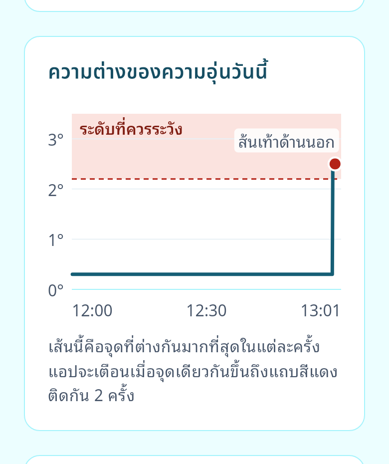
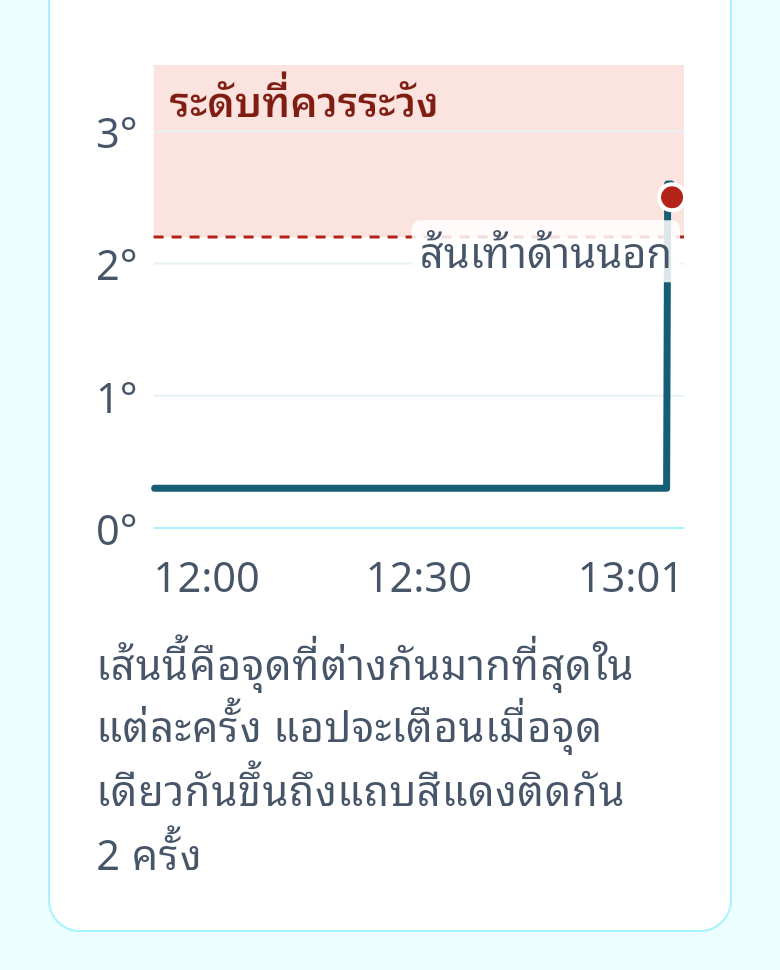

# 038 — S8D-2: the UI for 8 sites

Branch `work/flutter-8-sensors-ui` · 2026-10-31 · requires S8D-1 (PR #33,
merged 530e735). Plan approved 2026-10-31 with the user's decisions and two
additions (below). Emulator and goldens only: no Note 10 checkpoint was
needed (nothing in BLE, storage, rules or capture changed).

## Summary

- **Temperature tab, layout A** (user decision 2026-10-29):
  - card "ความอุ่นซ้าย–ขวา ตอนนี้" with both feet's 8 sites, the legend
    "จุดที่อุ่นกว่า / ใกล้เคียงกัน / ยังวัดไม่ได้", and the 3 sites with
    the largest difference;
  - one chart line, the largest |ΔT| of the 8 sites, with the end point's
    site named (dropped when it cannot sit next to the dot), and the note
    "เส้นนี้คือจุดที่ต่างกันมากที่สุดในแต่ละครั้ง แอปจะเตือนเมื่อจุดเดียวกันขึ้นถึงแถบสีแดงติดกัน 2 ครั้ง" (wording decided after review);
  - the details table จุด / ซ้าย / ขวา / ต่าง × 8.

  The interim S8D-1 site cards, `shownSites` and the two-line legend are
  gone.
- **Alert-detail temperature map:** every qualifying site of the
  `TEMP_DELTA` is marked, the named one ringed, with a line listing them
  when there are 2 or more.
- **Dot sizes at 8 zones:** pressure 6 / 8 / 10 (no data and not recorded
  7, trigger ring + 5); temperature sites 8, ring 12. The left MTH1 and
  MTH2–3 no longer touch (report 037 screenshot 13).
- **BACKLOG 68:** Home's date line and the Alerts day titles follow the
  foot check's `todayProvider` (midnight timer + resume refresh). Three
  tests cross midnight and resume after a skipped day; all three fail
  without the fix.
- **Docs:** DESIGN-SPEC §1, §5 (geometry from `sensor_layout.json`,
  decision 3 closed), §6, §7.2, §7.3, §8.1, §8.2, §8.4, §8.5, §13, §14
  (decisions 23–29), Appendix A (zone names, S8D drafts, draft marking
  kept); FLUTTER-PLAN; `mobile/CLAUDE.md`; BACKLOG 68 resolved, 69–71 new.
- **Checks:** `flutter analyze` clean, 973 tests (952 before), 44 goldens
  regenerated and reviewed (2 new), emulator screenshots of every state.
  The spec review found 3 major and 3 minor issues, no blocker. The 4 code
  issues are fixed with tests that fail without them. For the 2 type
  sizes, the spec was wrong and is corrected (table below).
- **Your two additions:** a low dot (radius 6) on Home's 84×188 map is
  clearly visible at 100 % and 1.3, so the radii stay. The
  different-sites chart case is shown below.
- **After review (your decisions, 2026-10-31):**
  - the chart note now says the line can switch sites (option c), draft,
    in Appendix A for the medical review;
  - the end label is dropped when it cannot sit next to the dot (the third
    spot is gone, BACKLOG 70 resolved);
  - the temperature-site marks stay still (§12.2);
  - BACKLOG 69 goes with BACKLOG 60 in S10.

## What changed

| Commit | What |
|---|---|
| 981fca3 | BACKLOG 68: `HomeScreen` and the Alerts list watch `todayProvider`; `test/ui/day_rollover_test.dart` (3 tests) |
| 6f69932 | The 8-site UI: dot tokens, `TempSiteMap` with one `TempSiteMark` per site, `TempSiteDot`, `TempSiteLegend(items)`; `TempMapView.sites` / `sitesLine` / `marksOf`; `TempSiteView`, `tempSites`, `topSites`, `tempMapLabel`, `tempTable`; the chart model as one series (`ChartPoint.site`, `chartEndLabel`, one summary); `TempDeltaChart` draws one line with the end label; `joinTh` in `alert_copy.dart`; tests |
| fdd49f9 | Goldens at the new sizes and layout; new `my_feet_temp_two_sites_100/130` |
| 486626a | Docs (DESIGN-SPEC, FLUTTER-PLAN, `mobile/CLAUDE.md`, BACKLOG) |
| 5f16ba8 | From the emulator run: a third spot for the end label (under the gap label); the table's number columns grow with the text ("31.0" broke in two at 200 %) |
| e35530e | Spec review fixes (table below) |
| (this push) | Your decisions after review: the new chart note (`tempChartNote`), the third end-label spot removed, §8.2 / §12.2 / Appendix A, BACKLOG 60 / 69 / 70; 8 Temperature goldens regenerated |

## Decisions and how they were applied

| # | Decision (user, 2026-10-31) | Applied |
|---|---|---|
| 1 | Pressure radii 6 / 8 / 10, no data and not recorded 7, trigger ring + 5, legend unchanged | `FootDotColors`; the Pressure top-zone row dots use radius × 1.12 so they keep their old pixel size |
| 2 | A site is "จุดที่อุ่นกว่า" once one reading pair is above `deltaC` (Home's note rule); the ring only while `TEMP_DELTA` holds | `TempSiteView.warmer` / `markOn`, tested on the unrounded ΔT like Home (review finding 1); while the alert holds, its foot stays warmer even if the newest pair has dropped under the threshold (test) |
| 3 | Top-3 rows show "{x.x}°" | Rest text colour and `octagon-alert` while `TEMP_DELTA` holds there |
| 4 | BACKLOG 68 covers Home and the Alerts titles | Both; the two pushed foot-check screens with the same pattern are BACKLOG 71 |

Also applied without a separate question:
- Temperature sites on both maps are radius 8 with a ring at 12, so a
  ringed MTH1 and MTH2–3 keep a gap.
- With a foot missing, every site on both maps is "ยังวัดไม่ได้" (dashed),
  and the missing foot's outline is dashed. A site with no two-foot normal
  pair is never drawn as "close" (rules 4 and 5).
- Top-3 order: sites where `TEMP_DELTA` holds first, then the largest
  |ΔT|, then zone order on ties.
- New draft copy is marked in code and in Appendix A:
  - the sites line "จุดที่อุ่นกว่าบนเท้าขวา: …";
  - map labels;
  - "ต้องเชื่อมต่อทั้งสองข้าง" / "ยังวัดไม่ได้" in place of the rows;
  - the chart note and summary.

## Your additions

### 1. A low dot on Home's 84×188 map

At 84×188 a radius-6 dot is about 8.4 dp across (23 px on the Pixel 7)
with its 2-unit outline. It is clearly visible at 100 % and at 1.3. The
map does not scale with text, so the dots are the same size in both. No
radius change.

- [03 — Home map, phone scale 1.0](038-flutter-8-sensors-ui/03-home-map-100-crop.png)
- [04 — Home map, phone scale 1.3](038-flutter-8-sensors-ui/04-home-map-130.png)

Shots 01–04 were taken with the app's own text size at "ใหญ่" (left over
on the emulator from an earlier session). The map is fixed-size, so this
does not change the dot check. Every later shot uses "ปกติ", and the
setting was put back to "ใหญ่" afterwards.

### 2. Two readings above the band in a row from different sites

**Test.** `temp_chart_model_test.dart` › "two points above the band in a
row from different sites (no TEMP_DELTA…)":
- reading 8 has MTH1 at +2.6 °C, reading 9 has the lateral heel at
  +2.5 °C, everything else is low;
- the line's last two points are above `deltaC` and come from sites 1
  and 7;
- the end label is "ส้นเท้าด้านนอก";
- the summary reads "จุดที่ต่างกันมากที่สุดขึ้นถึงระดับที่ควรระวังตั้งแต่ราว 08:04
  ตอนนี้ 2.5 องศาที่ส้นเท้าด้านนอก".

The alert side is the existing engine test "per site: two different sites
above once each is no alert" (`alert_engine_test.dart:348`).

**Screenshot.** Golden `my_feet_temp_two_sites_100/130`: a hand-made
12:00–13:00 hour where the last two readings are those two pairs, on the
`safe` live preset, with the live readings not stored.

How it reads:
- **The line.** On an hour-wide axis, two readings 30 s apart are about
  9 px apart. They show as one spike into the red band, with a red end
  dot.
- **The end label.** It names only the last site ("ส้นเท้าด้านนอก"),
  which is true for that point. Nothing on the chart says the point
  before it was MTH1.
- **The note.** At first it read "แอปจะเตือนเมื่อจุดเดียวกันขึ้นถึงแถบ
  สีแดงติดกัน 2 ครั้ง", the only clue that this spike will not raise an
  alert. Reading it needed the word "จุดเดียวกัน" and the knowledge that
  the line can switch sites. **Now (your decision c):**
  "เส้นนี้คือจุดที่ต่างกันมากที่สุดในแต่ละครั้ง แอปจะเตือนเมื่อจุดเดียวกันขึ้นถึงแถบสีแดงติดกัน 2 ครั้ง" (draft). The first sentence says the line can switch
  sites. The screenshots above show the new note.
- **The banner.** It stays "สองข้างอุ่นใกล้เคียงกัน" (Safe), which is
  correct: no `TEMP_DELTA` holds.

What a patient sees, then:
- a red-band spike and a red dot;
- a Safe banner;
- no alert, then or later.

A user who reads the band as "the alert line" could expect an alert that
never comes. The opposite case (the same site twice) looks identical on
the chart and does alert.

Two caveats about the screenshot:
- **The map is not live-consistent.** The live mock is `safe`, so the map
  shows every site as close. In real use the lateral heel would also be
  marked "จุดที่อุ่นกว่า" on the map (one reading above, decision 2), and
  the top row would read "ส้นเท้าด้านนอก · เท้าขวาอุ่นกว่า · 2.5°".
- **At 130 % the label moves below the dot.** There is no room above it,
  and its backdrop covers a short stretch of the dashed threshold line
  (BACKLOG 70).

No chart feature was added for this, as you asked. After review you
chose option (c), rewording the note (above). The screen test "the chart
has a spoken summary" now also checks the note's text.

## Verify

### Static checks and tests

- `flutter analyze`: no issues.
- `flutter test`: 973 passed (952 on main). New or changed:
  - `test/ui/day_rollover_test.dart` (4: BACKLOG 68, and a midnight
    timer that fires on the old day);
  - `test/widgets/temp_delta_chart_test.dart` (an end label wider than
    the plot is dropped);
  - `temp_chart_model_test.dart` (one series, max of 8 with its site,
    ties to the lower zone, unreadable sites left out, no point without a
    two-foot site, the different-sites case, the three summary forms);
  - `my_feet_copy_test.dart` (site states, the threshold edge, a held
    alert after a reading below, rule 4/5 with a foot missing or a site
    unreadable, top-3 order, map labels, the table);
  - `alert_view_test.dart` (one site / several sites: marks, ring, sites
    line, labels);
  - `my_feet_screen_test.dart` (rest: rows and ringed sites on the right
    map; one foot missing: no rows, every site unreadable, missing foot
    dashed; the spoken summary);
  - `alerts_screen_test.dart` (two-site TalkBack label and sites line);
  - `sample_day_test.dart`.
- `no_threshold_literals_test`: passes (`joinTh` uses only allowed
  literals).
- Goldens: 44 changed or new. Each changed screen was reviewed at 100 %
  and 200 %:
  - Home (every state): smaller dots, nothing else moved;
  - My feet pressure (safe, orange dot, watch with numbers, no data, one
    foot): the high MTH1 next to MTH2–3 has a gap;
  - Temperature (safe, rest with numbers, one foot missing; new
    two-sites);
  - alert details (TEMP_DELTA with 2 sites, the pressure codes with the
    ring at + 5);
  - the tabs overview.

  CoP (Gait) did not change.

### Rules (FLUTTER-PLAN §6)

| Rule | How |
|---|---|
| 2 | The day comes from the clock at read time (`todayProvider.build` / `refresh`); the midnight timer only asks for a re-read. A resume after a skipped day shows the new day (test) |
| 4 | With a foot missing: no top rows, every site unreadable, "ต่าง" is "—", the chart's pairing is unchanged. Tests in `my_feet_copy_test` and `my_feet_screen_test` |
| 5 | Unreadable sites are white with a dashed `inkSubtle` outline (the No-data dot), never "ใกล้เคียงกัน"; the rows are hidden behind "ยังวัดไม่ได้" / "ต้องเชื่อมต่อทั้งสองข้าง" |
| 6 | The engine is unchanged (per site). The chart line can switch sites; the note says "จุดเดียวกัน" and the different-sites case is tested and shown above |
| 12 | Radii and sizes are theme tokens; `deltaC` and `consecutiveReadings` come from `thresholds.json` |
| 13 | Alert advice unchanged |
| 16 | The chart's draw-in is unchanged (off under reduce motion). The temperature maps are still (no tween), as `TempSiteMap` was in S8D-1; §12.2 now says so (your decision) |

### Emulator (Pixel 7 AVD, API 37; driver build, `MOCK=rest`, presets switched live)

Seeded with "Seed sample alerts" and "Seed sample day" once each after a
hot restart. An earlier double tap seeded twice (the second run fills
00:00–08:00, a debug-tool quirk), so the in-memory database was reset.

| # | Shot | What it shows |
|---|---|---|
| 01 | [Home, rest](038-flutter-8-sensors-ui/01-home-rest-100.png) | Date line "วันเสาร์ 31 ตุลาคม" (BACKLOG 68 path) |
| 02–04 | [Home map](038-flutter-8-sensors-ui/02-home-map-100.png), [crop](038-flutter-8-sensors-ui/03-home-map-100-crop.png), [1.3](038-flutter-8-sensors-ui/04-home-map-130.png) | Your addition 1 |
| 05 | [Temperature, rest, top](038-flutter-8-sensors-ui/05-temp-rest-top.png) | Banner; right heel centre and lateral heel ringed; left foot all close |
| 06 | [Rows and chart](038-flutter-8-sensors-ui/06-temp-rest-rows-chart.png) | Rows 2.6° / 2.3° in Rest colour with the icon, 0.0° close; one line, end label "กลางส้นเท้า" below the dot, gap label, note |
| 07 | [Numbers](038-flutter-8-sensors-ui/07-temp-rest-details.png) | Table × 8, "กลางส้นเท้า 4 ครั้ง (เกณฑ์ 2 ครั้ง)", "ดีทั้ง 16 จุด" |
| 08 | [Alerts list](038-flutter-8-sensors-ui/08-alerts-list.png) | "วันนี้" titles |
| 09 | [TEMP_DELTA detail map](038-flutter-8-sensors-ui/09-alert-temp-delta-map.png) | Both qualifying sites marked, heel centre ringed, sites line (wraps inside "ส้นเท้า|ด้านนอก", BACKLOG 69) |
| 10 | [Pressure, watch](038-flutter-8-sensors-ui/10-pressure-watch.png), [MTH crop](038-flutter-8-sensors-ui/10b-pressure-watch-mth-crop.png) | High left MTH1 next to medium MTH2–3, apart |
| 11 | [Temperature, close](038-flutter-8-sensors-ui/11-temp-close-watch.png) | All sites close, rows 0.3° "ใกล้เคียงกัน" |
| 12–13 | [One foot missing](038-flutter-8-sensors-ui/12-temp-one-foot-missing.png), [rows and chart](038-flutter-8-sensors-ui/13-temp-one-foot-missing-rows.png) | Every site unreadable, right outline dashed, "ต้องเชื่อมต่อทั้งสองข้าง"; open gap; end label under the gap label |
| 14 | [No data](038-flutter-8-sensors-ui/14-temp-no-data.png) | Both feet dashed |
| 15–17 | [1.3 top](038-flutter-8-sensors-ui/15-temp-rest-130-top.png), [rows](038-flutter-8-sensors-ui/16-temp-rest-130-rows.png), [chart](038-flutter-8-sensors-ui/17-temp-rest-130-chart.png) | Layout holds at 1.3; the end label goes under the gap label, away from the dot (BACKLOG 70) |
| 18–19 | Goldens, your addition 2 | Above |
| 20 | [Golden, rest at 200 %](038-flutter-8-sensors-ui/20-golden-rest-chart-200.png) | After your decision: no spot next to the dot is free, so the end label is dropped; the banner names the site |

Shots 06, 12–13 and 15–17 were taken before your decisions. They show
the old note, and in 12–13 and 15–17 the end label under the gap label.
Those charts now drop the label, as golden 20 shows.

Two things found on the emulator and fixed (5f16ba8):
- **The end label was dropped on the sample day.** The band label sits at
  the right there, and the gap label sits by the dot. A third spot under
  the gap label now applies. *(Removed after review, at your decision:
  the label is dropped instead.)*
- **The table broke numbers at 200 %.** "31." / "0" split in the 52 px
  columns. The number columns are now at least 52 px and grow with the
  text.

## Independent review (spec vs implementation)

`spec-reviewer` on `git diff main...HEAD` (at 5f16ba8), sections
DESIGN-SPEC §1, §2, §5, §6, §7.2, §7.3, §8.1, §8.2, §8.4, §12, §13, §14
(23–29), Appendix A; FLUTTER-PLAN §6 rules 1, 2, 4, 5, 6, 12, 13, 16;
DATA-CONTRACT v1.6 `details.tempSites`; BACKLOG 68. No blocker. Copied as
returned (paths shortened), with a resolution column. Fixes in e35530e.

| # | Severity | File:line | Finding (spec vs code; fix) | Spec reference | Resolution |
|---|---|---|---|---|---|
| 1 | major | `my_feet_copy.dart:335` (rule at `:342`) | The spec says a site is "warmer" once one reading pair is above `deltaC`, using Home's note rule. Home (`home_model.dart:307`) and the engine (`alert_engine.dart:397`) test the **raw** ΔT. The tab tests `v.delta(site)` instead, which is rounded to 0.1 °C (`_round1`, `my_feet_model.dart:394`). With `deltaC` 2.2, a raw ΔT from 2.205 up to just under 2.25 is "above" for Home and the engine, but rounds to 2.2 here. The map and row then say "ใกล้เคียงกัน" while Home says the foot is warmer. **Fix:** keep the unrounded per-site ΔT in `TempTabView` and pass that to `deltaAbove`; use the rounded value only for display. | §8.2, §8.4 "Sites", §14 decision 27 | **Fixed.** `TempTabView.warmerAbove` is computed by `warmerOf(raw ΔT, deltaC)` (the engine's `deltaAbove`); the rounded `deltaC` is display only. Test: 2.21 shows "2.2°" and is warmer; `warmerOf` edge cases. §8.2 now says the test uses the unrounded ΔT |
| 2 | major | `my_feet_copy.dart:396` | The TalkBack label of the other foot is wrong when one foot has warmer sites. If the right heel is warmer, the left map reads "เท้าซ้าย ใกล้เคียงกับเท้าขวาทุกจุดที่วัดได้" (close at every measured site), and `my_feet_copy_test.dart:396-397` asserts this. The spec separates "close" ("Plain on both feet when the two feet are close") from the other foot's plain dot at a warmer site. So the label states a closeness that the right map contradicts. **Fix:** use "close at every site" only when no site has a warmer foot; otherwise name the sites where the other foot is warmer, as the alert detail does with its other-foot label. | §8.2, §13 | **Fixed.** The other foot now reads "เท้าซ้าย ไม่มีจุดที่อุ่นกว่าเท้าขวา" (draft); "ใกล้เคียงกับ…ทุกจุดที่วัดได้" only when no site has a warmer foot. The right map's label already names the sites, so the left one does not repeat them. Test updated, §13 lists the three forms |
| 3 | major | `temp_delta_chart.dart:396` | The spec says the end label is "dropped rather than … leave the plot". The code runs `(c.dx - e.width).clamp(plot.left + 4, plot.right - 4 - e.width)` before its `free()` width check. When the site name is wider than the plot minus 8 px, the lower limit exceeds the upper and Dart's `clamp` throws `ArgumentError` inside `paint`, with `canvas.restore()` still pending. This can happen with long names such as "โคนนิ้วหัวแม่เท้า" at "ใหญ่ / ใหญ่มาก" × 200 % phone text; the 200 % goldens did not use that name. **Fix:** drop the label (or skip the clamp) when `e.width > plot.width - 2 × textGap`, before clamping. | §8.2 end label; §2/§13 | **Fixed.** The label is dropped when its bounds would cross, before the clamp. New `test/widgets/temp_delta_chart_test.dart` (140 px chart, 2× text, site 1) throws without the fix |
| 4 | minor | `footcheck_providers.dart:42-46` | The spec says the Home date line and the Alerts day titles roll over at local midnight. If the midnight `Timer` fires while the wall clock still reads the old day (the wall clock moved back during the day, e.g. NTP or a time-zone change), `refresh()` sees the same day, does not invalidate, and arms no new timer. Home and Alerts then keep the old day until the next resume. Before this change, Home read the clock on every rebuild, so this did not happen. **Fix:** in `refresh()`, when the day has not changed, re-arm a timer to the next midnight (or always `invalidateSelf()`). | §6 item 1, §7.2; BACKLOG 68; rule 2 | **Fixed.** `refresh()` re-arms the timer to the next midnight when the day has not changed. New test (clock set back an hour at 23:30) fails without the fix. This also fixes the foot-check card, which used the same provider before S8D-2 |
| 5 | minor | `temperature_tab.dart:139` | The spec gives the map card's "ซ้าย"/"ขวา" labels as **18/600** `inkMuted`; the code uses `AppText.labelStrong`, which is 16/600. **Fix:** use `AppText.bodyStrong` with the `inkMuted` colour. | §8.2 | **Spec corrected.** The code matches the Pressure card it is modelled on (`pressure_tab.dart`, 16/600) and Home (§6); "18/600" was my error when writing §8.2 in 486626a. §8.2 now reads 16/600 "as on Pressure" |
| 6 | minor | `temperature_tab.dart:235` | The spec gives the top-3 rows' "{x.x}°" as **18/700**, tabular; the code uses `AppText.labelStrong` with w700, which is 16/700. **Fix:** use `AppText.button` (18/700) or `bodyStrong` with w700, keeping tabular figures and the Rest colour. | §8.2, §14 decision 28 | **Spec corrected.** 16/700 matches Pressure's level word in the same position (§8.1); decision 3 set the content, not the size. §8.2 now reads 16/700 |

Spec gaps the reviewer listed, and what happened:

| Gap | Resolution |
|---|---|
| §13 did not give the non-warmer foot's label when the other foot has warmer sites | Closed with finding 2 (§13) |
| §12.2 "Dots tween" does not say whether temperature-site marks tween; they are still | Your decision: they stay still. §12.2 now says pressure dots tween and the temperature-site marks change at once |
| §8.2 says "under the gap label" only when the band label is at the right and the gap label by the dot; the code tries it whenever a gap label exists | Your decision: the third spot is removed. The label is dropped when it cannot sit next to the dot; §8.2 updated |
| §8.2 / decision 27 did not say raw or displayed ΔT | Closed with finding 1 (§8.2) |

## Leftovers and notes for the next sessions

- BACKLOG 69: the alert-detail sites line can break inside a site name
  at 100 %. Scheduled with BACKLOG 60 in S10.
- BACKLOG 70: resolved (the third spot is removed). Below the dot, the
  label's backdrop still covers a short stretch of the threshold line,
  which you accepted.
- The new chart note is draft copy in Appendix A, for the medical review
  before 2026-11-05.
- BACKLOG 71: `compare_screen.dart` and `photo_history_screen.dart` read
  the day at build (the BACKLOG 68 pattern), minor.
- The top-3 "{x.x}°" values do not animate. The old site cards'
  `AnimatedNumber` went with them; the spec never asked for it.
- Test log noise, not a failure: the day-rollover tests print "reminder:
  sync failed: Cannot use the Ref … after it has been disposed". The day
  changes, the reminder service queues a sync, and the test ends before
  it runs. The service catches and logs it; it also happens with the old
  provider. Harmless in the app, which is not torn down at midnight.
- `docs/SESSIONS.md` status row: S8D still shows ⏳ (S8D-1 is merged,
  S8D-2 is this PR). Left for you to set at merge, as with earlier
  sessions.

## Decisions needed

None open. The two from the first version of this report were decided on
2026-10-31 and applied:
1. The different-sites chart case: option (c), the reworded note.
2. BACKLOG 70: the end label is dropped when it cannot sit next to the
   dot.

## Next session

S9 (1–3 Nov, schedule v2.6) after this PR is merged.
